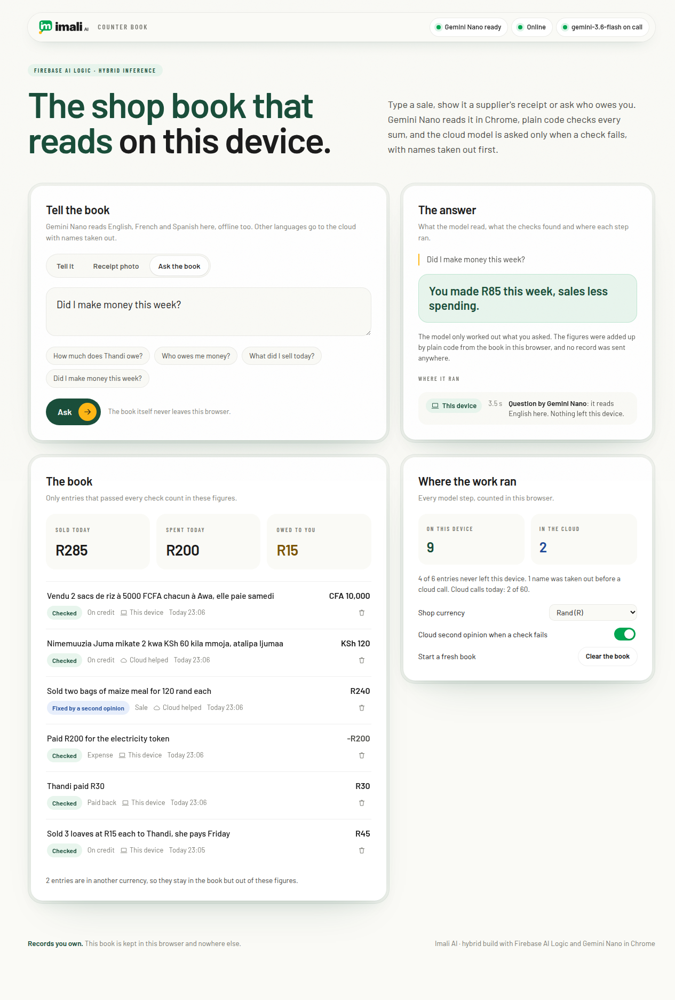

# Imali AI book: the shop book that reads on the device

Imali AI runs sales, stock and books on WhatsApp for shop owners and merchants, along with their suppliers, their funders and groups of companies. This repository is a Chrome web app built for the #BuildHybridAI hackathon. It is a counter book that a shop owner writes in plain words. Gemini Nano reads each entry on the device through Firebase AI Logic, plain code checks every reading before it counts in the totals, and a cloud Gemini model is asked only when the device's reading fails a check. Customers' names are taken out before any words leave the device, and an entry made offline waits for the connection.

This README is for the hackathon's judges and for developers who want to run the app. The first sections say what it does and why; the code names are in the Firebase table and the run instructions.



The same screen at phone width is in [docs/screenshots/book-390.png](docs/screenshots/book-390.png).

## Why a shop book needs both models

A small shop's book holds its customers' names and what each one owes. Many owners still keep it in a paper exercise book. A cloud app would cost them data and stop working where the signal drops, and it would send their customers' names to a server. A model that runs on the device avoids those costs. But a small model also makes mistakes with money, and a book that is wrong one time in ten is worse than paper.

We saw this on the first day. On 12 November 2026 Gemini Nano read "Sold two bags of maize meal for 120 rand each" as two bags at R60 each, a total of R120 instead of R240. The arithmetic of its answer was consistent, so a sum check alone would have passed it. The words said "each", and the book's checks caught it there.

So this book never trusts a model with arithmetic, and it never sends the whole book anywhere.

## How an entry is read

1. Gemini Nano reads it on the device. The app asks Firebase AI Logic to use the model on the device only, when Chrome's language detector names a language Nano reads or is unsure, as it often is on a short message. For a receipt photo the app lets Firebase choose: Nano when the device has it, the cloud model when it does not. A supplier's receipt carries the supplier's printed details and no customer's name, so the photo goes as it is. Both models are given the same form to fill in (the kind of entry, each item's quantity, price and line total, the total, the currency, the person and when they will pay), so their answers can be checked the same way.
2. Code checks the reading. The checks run in microseconds and work offline. Each line's quantity times price must equal its line total, and the lines must add up to the total. A price the words mark with "each", "per", "@", "chacun" or "kila mmoja" must be a price for one item. Every number must come from the words or follow from them, and the currency must match the one the words name. A sale the words say is paid later must be recorded on credit, and a debt or payment must name the person.
3. The cloud gives a second opinion only when needed. If a check fails, or Chrome is sure the words are in a language Nano does not read here (Kiswahili and isiZulu in our tests), the words go to the cloud model. Before they leave the device, names and phone numbers are swapped for placeholders such as `[PERSON_1]`, and swapped back when the answer returns. The second opinion is told which checks failed, and its answer has to pass the same checks. If it does not, the entry is marked "Needs you" and stays out of the totals. If the cloud model asked first gives no usable answer within 60 seconds (120 for a photo), the other cloud model is asked once, the two calls together never take more than 90 seconds (180 for a photo), and the step says so. We added this on 12 November, when gemini-3.8-flash on the free tier answered "high demand" or nothing for three minutes. An answer that still holds a placeholder instead of a name is not counted either.
4. Offline, the entry waits. When the cloud cannot be reached, the device's reading is kept with the reason it waits, and it stays out of the totals. When Chrome reports the connection is back, the waiting entries go for their second opinion.
5. Questions are answered by code. "How much does Thandi owe?" goes to Nano, which turns it into a small query: what to work out, for whom and for which period. Code adds up the figures from the book, which is stored in the browser on the device. When the cloud has to read a question, it gets the question alone, with names removed, and never a record.

Every model step is shown in the app under "Where it ran", with the model, the time it took and what left the device, and the ledger counts device and cloud steps.

## How Firebase is used

| Firebase product | What it does here |
| --- | --- |
| Firebase AI Logic | Every model call goes through it, to Gemini Nano in Chrome on the device or to the Gemini Developer API in the cloud. An entry is read on the device only (`InferenceMode.ONLY_ON_DEVICE`), and its second opinion goes to the cloud only (`ONLY_IN_CLOUD`). A receipt photo lets Firebase choose (`PREFER_ON_DEVICE`). Both models fill in the same JSON Schema: Nano gets it as the Prompt API's `responseConstraint`, the cloud model as `responseJsonSchema`. `response.inferenceSource` tells the app where each answer came from, and `initializeDeviceModel` downloads Nano when the owner clicks **Get it**. The cloud models (gemini-3.5-flash-lite for a reading, gemini-3.6-flash for a second opinion) and the cap of 60 cloud calls a day for one browser are set in `src/ai/firebase.ts`. Code: `src/ai/hybrid.ts`, `src/ai/prompts.ts`. |
| App Check | Enforced for AI Logic, so the cloud refuses a call that carries no valid App Check token. The hosted copy gets its token from reCAPTCHA Enterprise; a developer's machine uses the debug provider. Code: `src/ai/firebase.ts`. |
| Hosting | Serves the hosted copy. The app also installs as a web app and keeps working offline (`public/sw.js`). |

The checks are in `src/check/checks.ts`, the name removal in `src/privacy/redact.ts` and the book's store (IndexedDB) in `src/book/db.ts`.

## What we measured

The device runs were on 12 November 2026, in Chrome 157 on a Linux machine with 4 processor cores and no graphics card, so Gemini Nano ran on the processor. The first model download took 274 seconds.

| Entry or question | What happened on the device |
| --- | --- |
| Sold 3 loaves at R15 each to Thandi, she pays Friday | On credit, R45, Thandi, Friday. Checked, in 10 s. |
| Thandi paid R30 | Paid back, R30. Checked, in 8 s. Chrome's detector guessed Hindi at 0.55, so Nano tried it first. |
| Paid R200 for the electricity token | Expense, R200. Checked, in 7 s. |
| Sold two bags of maize meal for 120 rand each | 2 at R60 in one run: the "each" check failed, so it waited for the second opinion. Right (R240) in a later run. 7 s. |
| Vendu 2 sacs de riz à 5000 FCFA chacun à Awa, elle paie samedi | On credit, CFA 10,000, Awa, samedi. Checked, in 12 s. |
| The sample receipt photo (four lines) | Stock bought, R975, every line right. Checked, in 20 s. |
| How much does Thandi owe? | Thandi owes you R15. 4 s. |
| Who owes me money? | 2 people owe you R15 and CFA 10,000. 4 s. |

The cloud steps ran the same evening against the Firebase project, with App Check enforced for AI Logic:

| Step | What happened |
| --- | --- |
| Nimemuuzia Juma mikate 2 kwa KSh 60 kila mmoja, atalipa Ijumaa | Nano does not read Kiswahili here, so the words went to gemini-3.5-flash-lite with Juma's name removed. On credit, KSh 120, Juma, Ijumaa. Checked, in 9 to 23 s over three runs. |
| A second opinion on the wrong maize meal reading (2 at R60) | gemini-3.6-flash read 2 at R120, R240, in 9.8 s, and every check passed. gemini-3.5-flash-lite gave the same answer in 4.9 s. |
| The same second opinion with gemini-3.8-flash asked first | No answer within 60 s, so gemini-3.5-flash-lite was asked and gave R240, 67 s in all. That is why gemini-3.6-flash is the default. |
| A call to AI Logic without an App Check token | Refused with 401, "Firebase App Check token is invalid". |

In a second run of the six examples that evening, Gemini Nano read all five it can read correctly on the device, the maize meal included, and only the Kiswahili entry left the device. Its answers vary from run to run, which is why every reading goes through the checks.

## Run it

You need Node.js 20 or later and a Firebase project with AI Logic set up for the Gemini Developer API.

```sh
npm install
cp .env.example .env   # fill in your Firebase web app config
npm run dev            # http://127.0.0.1:5191
npm test               # the checks, the name removal and the answers
npm run build          # type check and production build into dist/
```

Without a `.env` the app still runs and reads on the device; the cloud steps then wait.

On your own machine, `npm run dev` uses App Check's debug provider: copy the debug token from Chrome's console into the Firebase console under App Check, Manage debug tokens. To keep one token, put it in `.env.development.local` as `VITE_APPCHECK_DEBUG_TOKEN`, never in `.env`, which a production build reads. Production builds leave the debug provider out.

## Use it

1. Open it in Chrome on a computer: Windows 10 or 11, macOS 13 or later, Linux, or a Chromebook Plus, with at least 22 GB free disk and either a graphics card with more than 4 GB of memory or 16 GB of RAM and 4 processor cores ([Chrome's requirements](https://developer.chrome.com/docs/ai/get-started)).
2. If the header says Gemini Nano is not downloaded, click **Get it**. The download runs once and then works offline. Without Nano, every reading goes to the cloud with names removed, and the app still works.
3. Click the example entries in order, then **Receipt photo** and **Use a sample receipt**, then **Ask the book**.
4. To see the offline queue, turn the network off in Chrome's developer tools (Network, Offline), add the maize meal example, then turn it back on.

## What was built during the hackathon

Every file in this repository was written from 12 November 2026, inside the contest period. Imali AI itself was built, tested and piloted with users from April 2026, and launched on 21 October 2026, as a WhatsApp product that runs its model calls in the cloud. None of that product's code is in this repository. From it we reused the brand (the logo and the Barlow font files), the product idea of a book kept from plain words, and what we learned about how shop owners write their entries. The on-device reading, the checks, the name removal, the routing between Nano and the cloud, the offline queue, the question answering and this interface are new.

## Licence

The code is under the Apache License 2.0 (`LICENSE`). The Barlow fonts are under the SIL Open Font License 1.1 (`public/fonts/OFL.txt`). The Imali AI name and logo are not covered by either licence.

Records you own.
